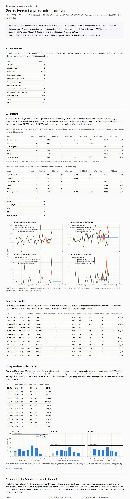

# Spares forecast and replenishment for Corvane Industrial

[](https://github.com/InanJaggi/spares-forecast-replenishment/actions/workflows/tests.yml)

A weekly planning pipeline for spare parts across three distribution centers. I forecast demand with
Nixtla's statsforecast, turn forecast error into safety stock, and build the replenishment plan with
one CP-SAT model from Google OR-Tools. A replay of 13 held-out weeks compares it with the current
hand rule. Corvane Industrial is a fictional customer and all data is synthetic.

## The Corvane scenario

Corvane makes centrifugal pumps and gearboxes and ships spare parts (seals, bearings, gasket kits,
impellers, couplings, wear rings) from DC-CMH, DC-DFW and DC-ATL. Fast movers stock out, slow movers
pile up, and planners reorder by hand with a blanket min/max of 4 and 10 weeks of average demand.
The data: 40 SKUs x 3 DCs = 120 series, 93 weeks (2025-01-06 to 2026-10-12), from four suppliers with
1 to 6 week lead times, MOQs and pallet sizes. Inbound freight is a box-truck shuttle (12 pallets per
truck, 1 or 2 dock slots per DC-week) and purchasing has a $250,000 weekly budget.

## Results

All numbers come from `python -m spares.pipeline`, captured in `docs/pipeline_run.txt`
(files in `docs/sample_output/`). Runtime on my laptop: 120 s.

Forecast accuracy (WAPE, pooled; lower is better):

| | seasonal naive | model chosen per series |
| --- | --- | --- |
| Backtest, 6 x 4-week windows before the holdout | 0.470 | 0.361 |
| Holdout, 13 weeks, 1 to 4 weeks ahead (out of sample) | 0.472 | 0.368 |

Mean MASE on the holdout: 1.090 for seasonal naive, 0.949 for the chosen models.

Holdout replay, 120 SKU-DCs x 13 weeks, simulated on synthetic demand (`docs/sample_output/simulation_summary.csv`):

| | optimized | hand rule 4/10 weeks |
| --- | --- | --- |
| Unit fill rate | 95.1% | 97.9% |
| Fill rate, slow movers | 83.3% | 73.8% |
| Stockout SKU-DC-weeks (of 1,560) | 94 | 78 |
| Average inventory value | $528,040 | $885,697 |
| Holding + ordering + shortage cost | $275,916 | $200,551 |
| Order weeks over budget / dock-weeks over capacity | 0 / 0 | 5 / 2 |

What this says, plainly: the optimized policy holds 40% less inventory and never breaks the budget
or dock limits, but it loses 2.8 points of fill rate against the 4/10 hand rule, and with my shortage
penalty that costs more in total. Against the hand rule set to a similar inventory level (2/8 weeks:
87.9% fill rate, $584,085, from `docs/sample_output/hand_rule_sweep.csv`) it is better on both. The weekly CP-SAT
re-plans stop at a 3 s limit and end with a mean 43% gap to the proven bound, so the replay
understates what the model can do with more solve time. The production plan (10 s) ends 5.6% from
the bound: 121 order lines worth $704,854 for the weeks starting 2026-10-19.



## Quickstart

```
python -m venv .venv
.venv/Scripts/python -m pip install -r requirements.txt
.venv/Scripts/python -m spares.pipeline        # writes data/ and out/plan.csv, out/report.html
.venv/Scripts/python -m pytest -q              # 6 tests, about 30 s
```

Settings (costs, budget, dock limits, service level, hand rule) live in `config/corvane.toml`.

## How it works

1. `spares/generate.py` writes seeded ERP-style exports: SKU master, shipped order lines, inventory
   snapshot. Demand mixes smooth fast movers, fast movers with a 13-week cycle (customers' quarterly PM
   schedules) and intermittent slow movers. The export has messy DC codes, re-exported lines, return
   credits, missing zero weeks and blank pallet sizes.
2. `spares/adapter.py` cleans that into statsforecast's `unique_id, ds, y` format. A test checks it
   recovers the generator's clean demand exactly.
3. `spares/forecast.py` splits series by average demand interval (Syntetos-Boylan). Fast movers get
   SeasonalNaive and AutoETS; slow movers get SeasonalNaive, CrostonOptimized, ADIDA and IMAPA.
   statsforecast's `cross_validation` backtests them and I keep the model with the lowest RMSE per
   series (MAE favored near-zero forecasts on slow movers, which the safety-stock math cannot use).
4. `spares/policy.py`: safety stock = z(95%) x backtest RMSE x sqrt(lead time + 1 review week);
   reorder point = forecast over that window + safety stock.
5. `spares/optimize.py`: one CP-SAT model for all DCs and the next 4 order weeks. It minimizes holding,
   order-line, per-pallet freight and lost-sales cost plus a soft penalty below safety stock, under MOQ,
   pallet rounding, dock capacity and the weekly budget. A reorder-point plan seeds the search.
6. `spares/simulate.py` replays the last 13 weeks: the optimized policy re-forecasts and re-solves each
   week and places that week's orders; the hand rule orders up to max at min. Same start stock,
   same demand, lost sales.
7. `spares/report.py` writes the static HTML report with matplotlib charts; `spares/pipeline.py` runs
   everything.

## Built on

Upstream, used as pinned pip dependencies and not modified (both Apache-2.0, see `NOTICE`):
statsforecast 2.1.1 (all forecasting models and `cross_validation`) and OR-Tools 9.15.6755 (the
CP-SAT solver).

I wrote: `spares/` (config, generate, adapter, forecast, policy, optimize, simulate, report,
pipeline), `config/corvane.toml`, `tests/test_spares.py`, and the docs. The segmentation, model
choice rule, metrics, safety-stock policy, the optimization model, the simulation and the report
are mine; the model fitting and solving are the libraries'.

## Limitations

- Synthetic data only. The costs, penalties and budget are my assumptions, not Corvane figures.
- Weekly re-plans in the replay are far from proven optimal at 3 s per solve (mean gap 43%).
- Safety stock assumes independent, roughly normal weekly errors; lead times are fixed.
- CP-SAT runs 8 parallel workers under a time limit, so repeated runs can differ slightly.
- Model choice and sigma come from the 80 weeks before the holdout and are reused for the plan.
- AutoETS with a 13-week season is the slow step (about 20 s per fit on this laptop).
- No vehicle routing; inbound freight is modeled as pallets against dock capacity.
